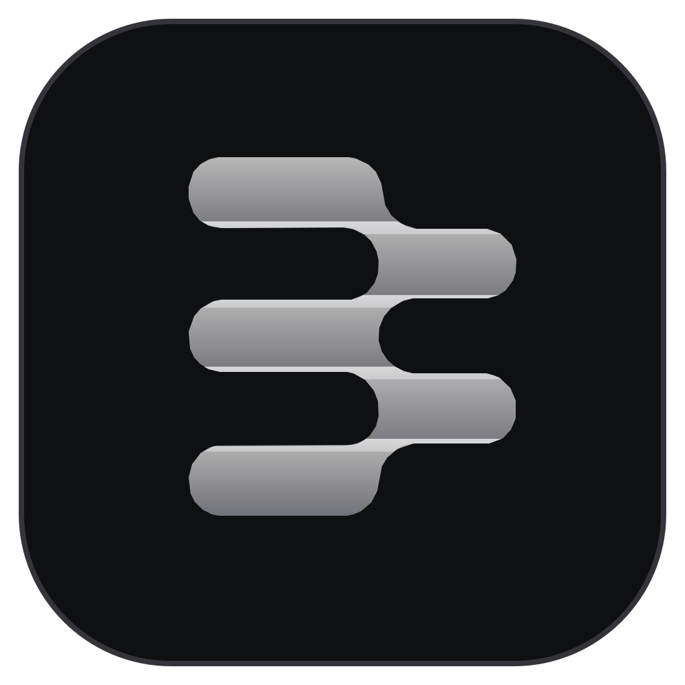
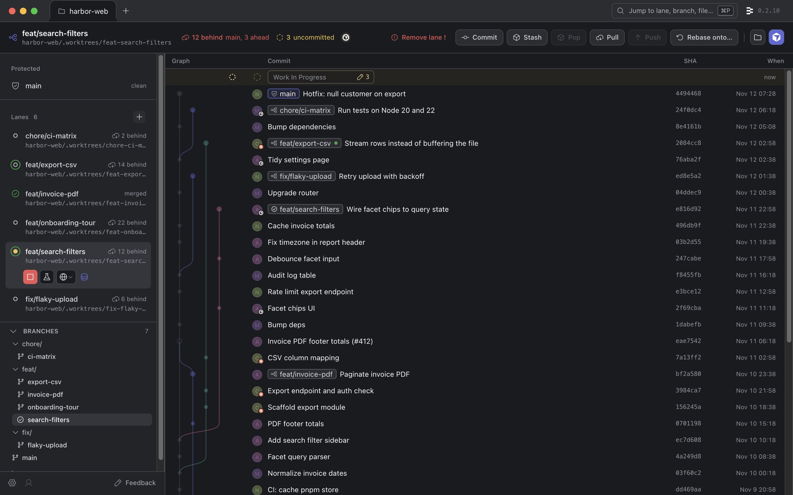

<div align="center">

<a href="https://plenum.sh"></a>

# Plenum

**A git client with lanes.**<br>
Parallel checkouts you start, stop, and test. You, your agents, every lane on one screen.

<sub><i>in plenum, adv.</i> — with everyone present.</sub>

<br>

<a href="https://plenum.sh"></a>

<br>

<a href="https://github.com/SigurdVilstrup/plenum/releases/latest"></a>


<a href="LICENSE"></a>

<br>

[**Website**](https://plenum.sh) &nbsp;·&nbsp;
[**Quick start**](#quick-start) &nbsp;·&nbsp;
[**Lanes**](#lanes) &nbsp;·&nbsp;
[**Agents & MCP**](#agents--mcp) &nbsp;·&nbsp;
[**Contributing**](CONTRIBUTING.md)

<br>

<a href="https://plenum.sh"></a>

</div>

<br>

## Why Plenum

You have three branches going, an agent working in a fourth, and main moving underneath all of them. Plenum puts that on one board: **Protected**, **Lanes**, and plain **Worktrees**, each with its own checkout, its own ports, and its own status.

<table>
<tr>
<td width="50%" valign="top">


### Lanes you can run

Each lane is its own checkout with its own ports. Start, stop, and test from the board, right next to protected main.

</td>
<td width="50%" valign="top">


### A real overview

How far behind main each lane is, what's uncommitted, and who wrote the last commit. You, an agent, or both.

</td>
</tr>
<tr>
<td valign="top">


### Built for busy team repos

Main stays protected. Every lane is measured against the team's branch, so you see drift before it hurts.

</td>
<td valign="top">


### Agents get lanes, not your git

Claude Code, Cursor, and Codex can create, start, and test lanes through the CLI and a local MCP server. Commits, pushes, and merges stay with you.

</td>
</tr>
<tr>
<td valign="top">


### Git verbs with a conflict walk

Commit, Push, Pull, Rebase, Finish. When a rebase or merge stops, Plenum walks you through each conflict instead of dumping you in a terminal.

</td>
<td valign="top">


### More than one repo

Every repo gets its own tab with its own lanes. **Cleanup…** (⌘K) clears finished lanes, worktrees, and stale local tips in one pass.

</td>
</tr>
</table>

## Quick start

1. Grab the signed build from **[plenum.sh](https://plenum.sh)**.
2. Open any repo from the empty screen or ⌘K.
3. Hit **Open as lane** on a worktree, or create a new one from the board.

Updates arrive on their own from the public feed at [plenum.sh/updates](https://plenum.sh/updates/). No GitHub token needed.

## Lanes

A **lane** is a worktree with Plenum's runner set up. Check in a `.plenum/lane.yaml` by hand, or fill it in as a form under **Settings → Lane**:

```yaml
# .plenum/lane.yaml
version: 1
run: python3 -m http.server {port.web}
test: node -e "process.exit(0)"
ports:
  offset: 100
  expose:
    web: 8000
```

Protected is lane 0 and keeps the base ports (`8000`). Lane 1 gets `web` on `8100`, lane 2 on `8200`, and so on, so every checkout can run at once.

- **Create / Open as lane** copies `env.copy` and runs `setup` when present.
- **Drift** gates Start when shared migrations are pending.
- **`plenum doctor`** finds hard-coded localhost ports and hands back an `agentPrompt`, so an agent can wire your app to lane ports while keeping defaults for non-Plenum starts. Writing the recipe alone isn't enough; the app has to read the ports.

## Agents & MCP

<p>


</p>

**Settings → Agents → Add** wires Cursor, Claude Code, or Codex in one click. On launch the app writes a bundled CLI to `~/.plenum/bin/plenum`, so there's no Node or `PATH` setup. For any other MCP client:

```json
{
  "mcpServers": {
    "plenum": {
      "command": "/Users/you/.plenum/bin/plenum",
      "args": ["mcp"]
    }
  }
}
```

| Tool | What it does |
| --- | --- |
| `repo.doctor` | Check the repo and return an `agentPrompt` for port wiring |
| `lane.create` | Create a new lane |
| `lane.up` / `lane.down` | Start or stop a lane's runner |
| `lane.test` | Run the lane's `test` command |
| `lane.status` | Board state as JSON |
| `lane.remove` | Remove a lane |

You decide what agents may do under **Settings → Agents** (`~/.plenum/agents.json`). By default they can start, stop, test, and create lanes; remove is allowed; writing `.plenum/lane.yaml` is off. Agents never get `force`.

The same verbs from a terminal:

```bash
plenum doctor [path]
plenum create <name> [path]
plenum up <lane> [path]        # lane 0 is protected
plenum status --json [path]
plenum test <lane> [path]
plenum down <lane> [path]
plenum remove <lane> [path]
```

## Develop

```bash
npm install
npm run smoke:init                              # disposable repo at tmp/smoke-repo
PLENUM_OPEN="$PWD/tmp/smoke-repo" npm run dev
```

<details>
<summary><b>All scripts</b></summary>

<br>

| Script | What |
| --- | --- |
| `npm run dev` | Vite HMR + Electron |
| `npm test` | Board, lane supervisor, doctor, CLI, MCP |
| `npm run smoke:init` | Fresh multi-worktree fixture with a local bare remote |
| `npm start` | Production build + Electron |
| `npm run pack` | Unsigned `Plenum.app` in `release/mac*` |
| `npm run release:check` | Tests + pack + launch + OTA/updater invariants (required before tagging) |
| `npm run dist` | Same + `.dmg` + updater `.zip` / `latest-mac.yml` |
| `npm run icons` | Rebuild `build/icon.icns` from `branding/app-icon-1024.png` |
| `npm run plenum -- …` | CLI (`doctor`, `status`, `up`, `down`, `test`, `create`, `remove`, `mcp`) |

Local pack and dist builds are unsigned. GitHub Releases are Developer ID–signed and notarized. Update feed notes for maintainers: [`docs/updates-feed.md`](docs/updates-feed.md).

- Disable auto-update: `PLENUM_DISABLE_AUTO_UPDATE=1`
- Override the feed: `PLENUM_UPDATE_FEED_URL=https://…/updates/`

</details>

<details>
<summary><b>Repo layout</b></summary>

<br>

| Path | What lives there |
| --- | --- |
| `app/` | Renderer |
| `electron/` | Main process, git ops, lane supervisor, tabs, MCP |
| `bin/plenum.mjs` | CLI + `plenum mcp` (stdio) |
| `branding/` | Icon masters |
| `site/` | Landing page for plenum.sh |
| `.agents/` | Shared agent skills, see [`AGENTS.md`](AGENTS.md) |

</details>

## Contributing

Plenum is in early beta and moving fast, which makes it a good time to shape it. Bug reports, ideas, and pull requests are all welcome. [`CONTRIBUTING.md`](CONTRIBUTING.md) covers tests, packing, and a short manual QA walk. The visual rules live in [`docs/design.md`](docs/design.md).

<br>

<div align="center">


<sub>Free and open source under the <a href="LICENSE">MIT license</a> · <a href="https://plenum.sh">plenum.sh</a></sub>

</div>
