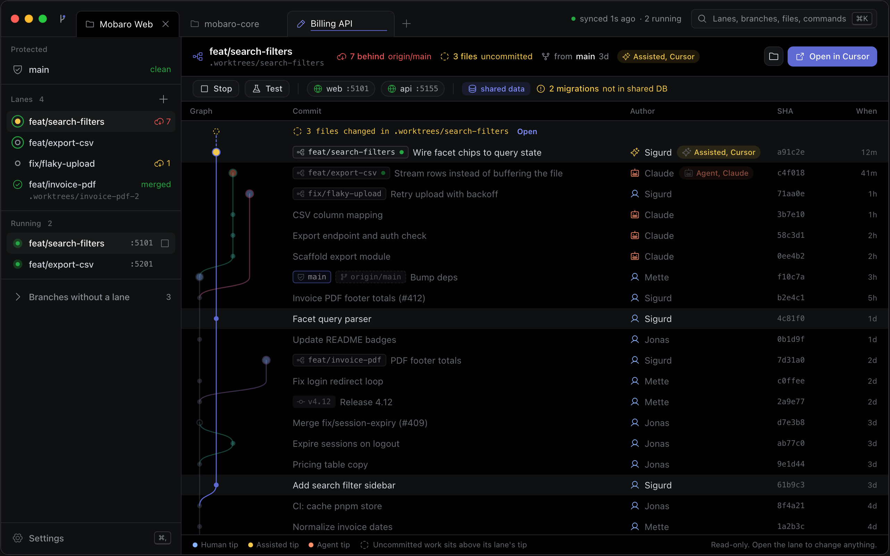

# Overlook

*Codename. The real name is not decided.*

A Mac git client for parallel work. Every branch you or an agent is working on gets a **lane**: a git worktree on its own branch, plus the way to run it. Overlook shows all lanes measured against the team branch, starts and stops them on their own ports, and hands the same controls to any agent over a local MCP.



## The problem

Worktrees are the right way to run several changes at once, and almost nobody uses them. Spinning one up means a second `pnpm install`, a port clash, a database the other checkout is already writing to, and a `.env` file that did not come along. So people work on one branch at a time, and agents that create their own worktrees leave them behind unrun and untested.

Git clients show worktrees and stop. Agent runners run their own workspaces and stop. Nothing shows the whole picture and makes every lane runnable.

## The idea

**See.** One board per repository. The protected checkout first, never touched by Overlook, red the moment something lands on it. Every lane with three facts: readiness, how far behind the team branch, and who wrote the tip (human, assisted, agent). Running is a ring on the mark and a row with the port.

**Run.** A file in the repo, `.overlook/lane.yaml`, says how a lane starts, tests and which services are shared. Overlook does not run your app. It calls your command (Aspire, docker compose, three shell scripts, `make dev`) with the lane's folder, a port offset and its env. Shared data is the visible default; migration drift against the shared database is the only thing that stops a Run.

**Hand off.** `overlook mcp` serves seven verbs to any agent, IDE or script: `repo.doctor`, `lane.create`, `lane.up`, `lane.down`, `lane.test`, `lane.status`, `lane.remove`. The same names exist as a CLI. Overlook never runs an agent, has no opinion about the model, and keeps no code inside anyone's editor.

```yaml
# .overlook/lane.yaml, proposed by the doctor, checked in with the repo
setup:  pnpm install
run:    pnpm nx run aspire-apphost:start   # yours; Overlook calls it
test:   pnpm nx affected -t test
ports:
  offset: 100                              # lane 1: 5101, lane 2: 5201
services:
  ravendb:  shared
  postgres: shared                         # snapshot available
```

## What it will not do

Commit, merge, rebase, push or resolve conflicts. Open a terminal into an agent. Interpret or replace the repo's own commands. Start anything in the protected checkout. Hide the fact that data is shared behind a dialog. Four writes in total: create a lane, remove a lane, write the manifest, start and stop processes. Everything else is read.

## Status

Nothing is built yet. This repository holds the planning work:

| Where | What |
|---|---|
| [planning/index.html](planning/index.html) | The pitch deck, 11 slides. Open it in a browser. |
| [planning/PRODUCT.md](planning/PRODUCT.md) | The full product memo: idea, vocabulary, must and must not, manifest schema, MCP and CLI, evidence from real repos, competitor audit, pre-mortem, decision notes and the ask. |
| [planning/DESIGN.md](planning/DESIGN.md) | The visual contract: tokens, icons, layout rules, motion, do and don't. |
| [planning/mocks/](planning/mocks/) | Clickable HTML mocks of the board, lane setup, settings and the agents page. Work from disk, no build. |
| [planning/examples/mobaro.lane.yaml](planning/examples/mobaro.lane.yaml) | A worked manifest for a real monorepo. |
| [planning/scripts/](planning/scripts/) | The git and PR mining that produced the numbers in the memo. |

The next step, from the memo: make one real repository runnable in lanes with the manifest and the CLI first, then build the Mac app around it. Details and the kill criteria are in [planning/PRODUCT.md](planning/PRODUCT.md#decision-notes).
